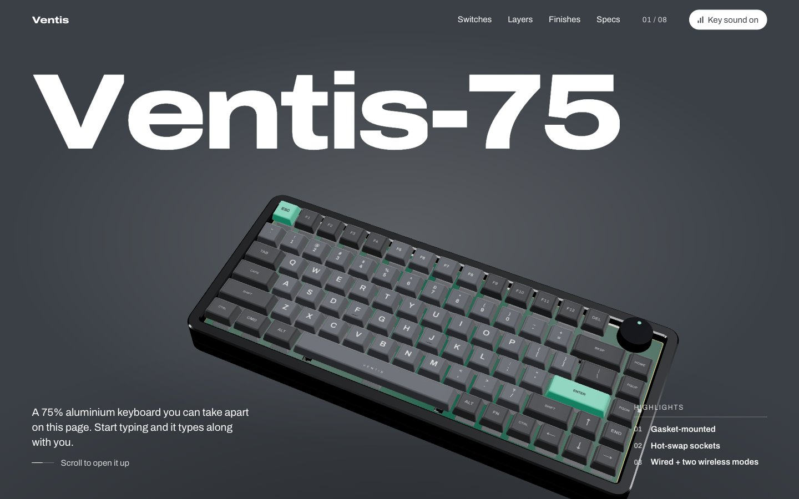
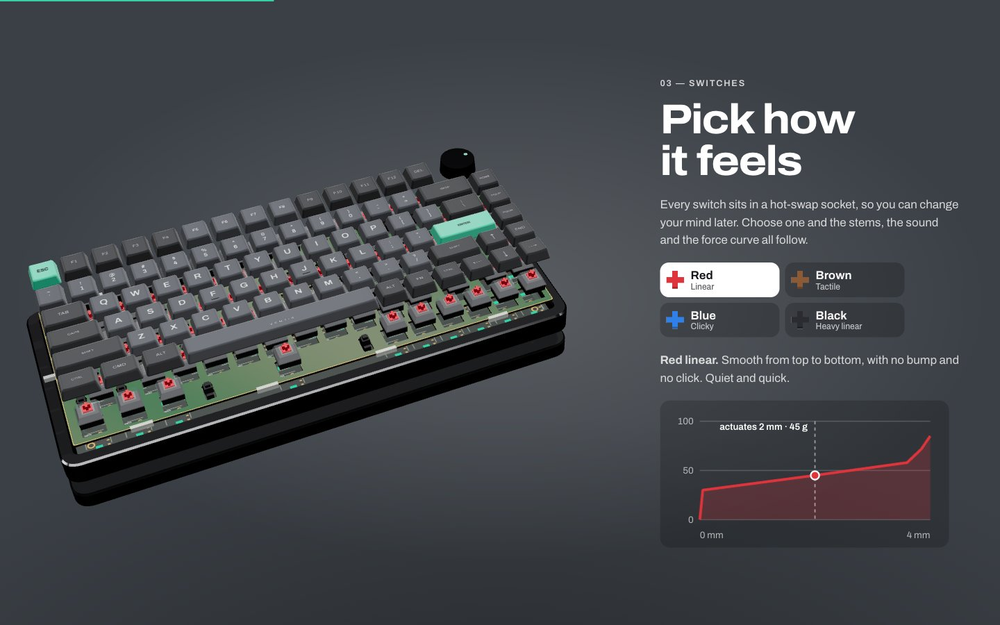

# Ventis-75

**Live demo:** _coming soon_ · Built by **windyoncloud**

An interactive 3D product page for **Ventis-75**, a concept 75% aluminium mechanical keyboard. Type on your own keyboard and the 3D one types along. Scroll to pull it apart into its seven layers, try four switch types, change the finish, flip it over to see the brass weight, and set it down on a desk.



| Switches | Anatomy | Finishes |
| --- | --- | --- |
|  |  |  |

Everything is procedural. There are no 3D model files, HDR maps or images: the keycaps, case, legends, knurling and studio lighting are all generated at runtime. Even the share image is drawn from the same key layout. The only media files are four small key-sound recordings (about 100 KB in total).

## Stack

- [Next.js 16](https://nextjs.org) (App Router)
- [React Three Fiber](https://r3f.docs.pmnd.rs) + [drei](https://github.com/pmndrs/drei) on [three.js](https://threejs.org)
- [GSAP](https://gsap.com) with ScrollTrigger for the load sequence and scroll-scrubbed camera poses
- Web Audio API for the key sounds: real recordings, with a synthesised fallback
- Archivo Variable via Fontsource

## Getting started

Requires Node.js 20.9 or newer.

```bash
npm install
npm run dev      # http://localhost:3000
```

Production build:

```bash
npm run build
npm start
```

## What's on the page

Before the page, a full-screen loader counts from 000 to 100. It is tied to real work rather than a timer: the 3D scene only mounts once the Archivo font is loaded (the key legends are drawn with it), and the counter only completes once the scene has rendered its first frames. The curtain then lifts and the intro plays.

| Section | What happens |
| --- | --- |
| **Hero** | The board swings in, the caps drop into place and a light wave runs across them. A short Highlights list sits in the corner. |
| **Type something** | Your physical keystrokes press the matching 3D keys. A live readout shows what you typed, your keystroke count, your speed in words per minute and the last key pressed. **Take the speed test** gives you a sentence to copy and ends with your words per minute, accuracy and time, plus a flare of the under-key lights. On touch screens the heading becomes *Tap the keys*: tapping 3D keys types, and the test opens the phone keyboard. |
| **Switches** | Pick Red (linear), Brown (tactile), Blue (clicky) or Black (heavy linear, with a deeper thock). The board half-opens so the stems show, and the stem colour, key sound and force curve all change with your pick. The spacebar presses once so you hear the new switch. |
| **Anatomy** | The board explodes into seven layers, each one starting a beat after the layer above it. Point at a row in the parts list (or tab to it) to lift that layer out of the stack. |
| **Finishes** | Four colourways: Basalt (the default), Signal, Persimmon and Sakura. The page backdrop, materials and glow all cross-fade, and a sweep runs across the keys. Clicking the knob on the 3D board cycles the finish too. A switch turns the accent Esc and Enter on or off, and you can drag the board sideways to turn it. |
| **Underside** | The board flips to show the numbered brass weight, the feet and the USB-C port. |
| **At the desk** | A lifestyle shot: the board sits low on a felt mat on a desk, under a warm side lamp. |
| **Specifications** | The full spec sheet. |

The keycap set is grouped the way premium sets are: F-keys in blocks of four, shifted sub-legends on the number and punctuation keys, homing bars on F and J, and a VENTIS wordmark on the spacebar.

Small details throughout: a header that slides away while you scroll down and returns when you scroll up, a progress line along the top edge, a section counter, a wordmark that drifts away as you leave the hero, copy that rises in section by section, a slow idle float on the board, pointer parallax, and a level meter on the sound toggle.

On the first visit a small note under the sound toggle says the keys make sound; the sound setting is remembered.

### Reliability and accessibility

- **No WebGL?** The page checks before mounting the scene. If WebGL is missing, or the scene fails to start, a flat SVG drawing of the board takes its place. It follows the same scroll poses and its keys still go down when you type. Add `?nogl` to the URL to preview it. The loader also gives up waiting after 12 seconds, so it can never hang.
- **Performance:** the canvas starts at 1.5× pixel density and a performance monitor moves it between 0.75× and 2× depending on the frame rate. Rendering pauses on its own when the tab is hidden.
- **Accessibility:** the canvas has a text description that follows the finish and switch, the parts list works from the keyboard, the page behind the loader cannot be tabbed into, and the test result is announced to screen readers.

Motion respects `prefers-reduced-motion`: the load sequence, idle float, scroll reveals and CSS animations are turned off, and the board simply follows the scroll.

## Behind the build

- **No model files.** The board is built from code: 82 keycaps from one shared geometry, the case from rounded extrusions, the legends from a single canvas texture atlas. That keeps the download small and lets a finish change retint every material at once, with no second model to load.
- **Real parts, drawn in code.** Keycaps have the cylindrical Cherry scoop and a grainy PBT finish, with legends that follow the scoop. Each switch has a dark lower housing, a smoked clear top, a cross stem and gold pins. The plate is cut with 82 switch holes and stabiliser slots and sits on ten gaskets. The circuit board texture is drawn to scale (traces, gold pads, a diode and silkscreen label per switch), and the case has a bead-blasted finish with a bright diamond-cut chamfer.
- **One pose per section.** Each section names a camera pose (position, rotation, scale, explode amount). GSAP ScrollTrigger scrubs between them, and the render loop reads plain mutable objects instead of React state, so scrolling never re-renders the component tree.
- **Real key sounds.** The first version synthesised every click and sounded fake. Each switch now plays one of eight real presses cut from CC0 recordings, never the same one twice in a row, with a small pitch and level jitter and an EQ that tames the close-miked highs. Safari keeps the MP3 encoder's leading silence, which put presses late, so the start of each file is measured on load and the slots are offset by it.
- **Always something to see.** If WebGL is missing or the scene crashes, an SVG drawing of the same layout takes over and still follows the scroll and your typing.

## Project structure

| File | What it does |
| --- | --- |
| `src/app/layout.tsx` | Root layout, metadata, font import |
| `src/app/globals.css` | All styles, including the CSS animations and the responsive layout |
| `src/components/Experience.tsx` | Page sections, the GSAP load timeline, scroll reveals, scroll-scrubbed poses, physical keyboard input and typing stats |
| `src/components/Scene.tsx` | Canvas, lights, the studio reflection map, adaptive resolution, the desk for the lifestyle shot and the pose rig (idle float, pointer parallax, drag-to-turn, responsive fit) |
| `src/components/Loader.tsx` | The 000–100 loading screen and its curtain exit |
| `src/components/Switches.tsx` | The force-curve chart and the switch picker |
| `src/components/Fallback.tsx` | The flat SVG board shown when WebGL is unavailable |
| `src/components/GLBoundary.tsx` | Catches a failing 3D scene so the page can switch to the fallback |
| `src/app/not-found.tsx` | The 404 page, three keycaps on the studio backdrop |
| `src/lib/site.ts` | Author name and the footer links (GitHub, portfolio); an empty link is hidden |
| `src/lib/content.ts` | Page copy: parts list, specs, highlights, underside facts, speed-test sentences |
| `src/lib/speedTest.ts` | Speed test scoring: new sentence, keystroke, words per minute and accuracy |
| `src/lib/browser.ts` | Reduced-motion, touch and WebGL checks, and safe localStorage |
| `src/app/opengraph-image.tsx` | The 1200 × 630 share image, generated at build time |
| `src/components/keyboard/Keyboard.tsx` | The model: caps (with homing bars and the spacebar wordmark), switches, plate, PCB, case, USB-C port, weight, knob, the glow shader, the staggered explode and the layer lift |
| `src/components/keyboard/layout.ts` | The 75% layout (82 keys) mapped to `KeyboardEvent.code`, colour groups and shifted sub-legends |
| `src/components/keyboard/geometry.ts` | Scooped keycaps, chamfered case slabs, the plate with its cutouts, and the switch and stabiliser parts |
| `src/components/keyboard/textures.ts` | Canvas textures: the legend atlas, PBT and bead-blast grain, brushed metal, the PCB artwork, knurl and engraving |
| `src/lib/store.ts` | Section poses (`POSES`), colourways (`COLORWAYS`), switch types (`SWITCHES`), key press state, layer focus and the key `wave` helper |
| `src/lib/sound.ts` | Key sounds: loads the recorded samples, plays a random press (and a lighter release) per key, falls back to a synthesised sound |
| `public/sounds/*.mp3` | One sprite per switch: eight single presses, one every 250 ms |

## Tuning

- **Camera angle per section:** edit `POSES` in `src/lib/store.ts`. `x` and `y` are fractions of the viewport, and `ny` is `y` on screens narrower than 900 px. There is one pose per `[data-scene]` section, in document order.
- **New finish:** add an entry to `COLORWAYS`. No new model is needed: the board is procedural and every material is tinted from the colourway, so the page backdrop, swatches and materials follow automatically. The first entry is the finish the page opens with (also update the `--backdrop` and `--accent` initial values in `globals.css` and `themeColor` in `layout.tsx` so the first paint matches).
- **New switch:** add an entry to `SWITCHES` in `src/lib/store.ts` (stem colour, force, actuation point and a force curve as `[mm, grams]` pairs), add its id to `SwitchSound` and `SOUNDS` in `sound.ts`, and put a sprite at `public/sounds/<id>.mp3`.
- **Your own key sounds:** replace a file in `public/sounds/` with a mono MP3 of the same layout: single presses, each starting at the top of its own 250 ms slot (eight is a good number). `LEVEL` in `sound.ts` balances the volume between switches.
- **Explode distances and timing:** `EXPLODE` and `STAGGER` in `Keyboard.tsx`. `FOCUS_LIFT` sets how far a hovered layer rises.
- **Footer links:** fill in the `href` values in `src/lib/site.ts`.
- **Speed test sentences:** `SENTENCES` in `src/lib/content.ts`.
- **Share image URL:** set `NEXT_PUBLIC_SITE_URL` to the deployed address so link previews use absolute URLs (on Vercel the production URL is picked up automatically).
- **Idle float:** the `float` and `sway` amplitudes in `Scene.tsx`.
- **Parts list:** `LAYERS` in `src/lib/content.ts`. Keep its order in step with `FOCUS_LIFT` in `Keyboard.tsx`.

## Sound credits

The key sounds are single presses cut from these recordings on [Freesound](https://freesound.org), all released under [CC0](https://creativecommons.org/publicdomain/zero/1.0/) (no attribution required, credited here anyway):

| Switch | Recording |
| --- | --- |
| Red | [Keyboard clicking typing Cherry Red Mechanical](https://freesound.org/people/handygaber/sounds/499773/) by handygaber |
| Brown | [Mechanical Keyboard Cherry MX Brown](https://freesound.org/people/majod/sounds/400167/) by majod |
| Blue | [Mechanical Keyboard 'Cherry Blue Switches'](https://freesound.org/people/EricsSoundschmiede/sounds/382057/) by EricsSoundschmiede |
| Black | [leopold fc980m pd cherry mx black](https://freesound.org/people/ujonathan/sounds/628325/) by ujonathan |

## License

© 2026 windyoncloud. All rights reserved. Ventis-75 is a concept, not a product for sale. The key sounds are CC0 (see above).
