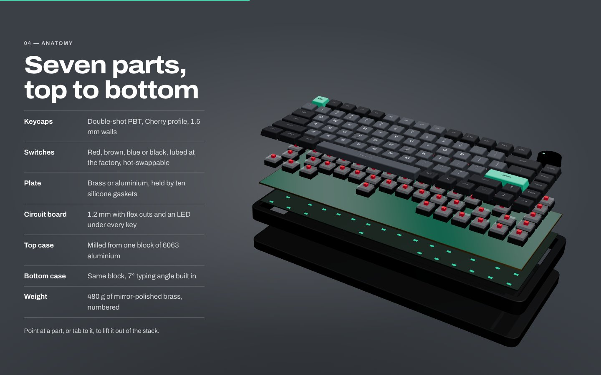
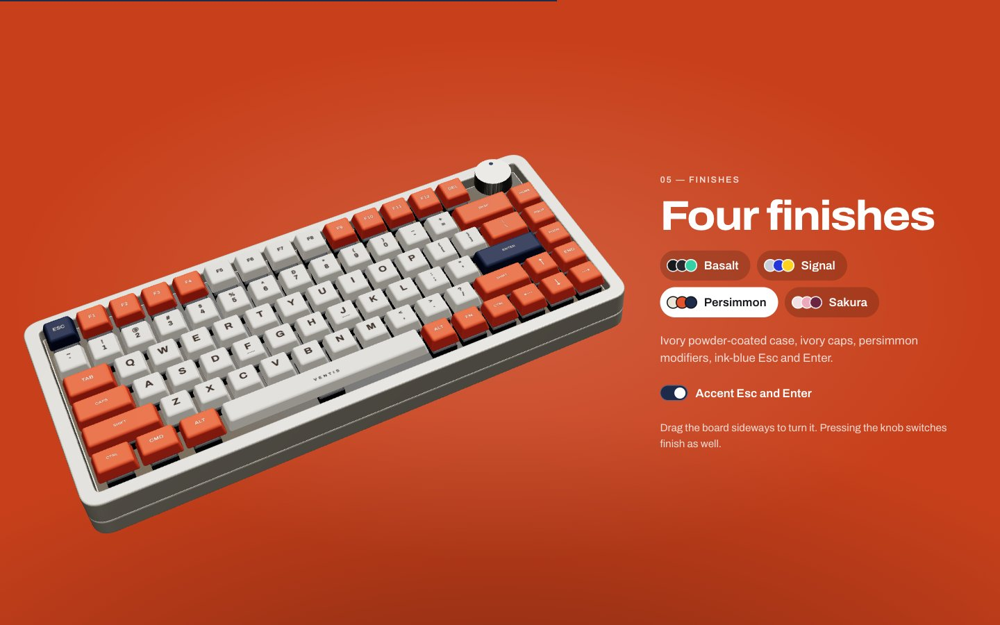

# Ventis-75

### A product page for a keyboard that doesn't exist.

Ventis-75 is a concept 75% board I made to try out scroll-driven 3D in the browser. Type on it, pull it apart, swap the switches and change the finish.

**[Live demo](#)** · coming soon


| Switches | Anatomy | Finishes |
| --- | --- | --- |
|  |  |  |

## Features

- Type on your real keyboard and the 3D one presses the same keys. There's a small speed test too (WPM and accuracy).
- Four switches (Red, Brown, Blue, Black), each with its own stem colour, force curve and recorded sound.
- Scroll to explode the board into seven layers; hover a part in the list to lift it out.
- Four finishes: Basalt, Signal, Persimmon and Sakura. Click the knob to cycle them.
- Works on phones (tap the keys), falls back to a flat SVG if WebGL isn't available, and respects reduced motion.

## Stack

Next.js 16, React Three Fiber + drei, three.js, GSAP ScrollTrigger and the Web Audio API.

## Running it

Needs Node 20.9+.

```bash
npm install
npm run dev
```

`npm run build && npm start` for a production build. Add `?nogl` to the URL to see the no-WebGL fallback.

## Notes

There are no model files or images in the site. Everything is built in code: keycaps (with the Cherry-profile scoop), switches, the plate with its cutouts, the PCB artwork and the case. That keeps it small and means a new finish is just a set of colours.

Each section has a camera pose, and GSAP scrubs between them as you scroll. The render loop reads plain objects rather than React state, so scrolling doesn't cause re-renders.

The first version synthesised the key sounds and they sounded fake, so I swapped in short clips cut from real recordings (credits below). Safari adds a bit of silence at the start of MP3s, which made the clicks late; the code measures it and skips it.

## Where things are

- `src/components/Experience.tsx`: the page, scroll animation and keyboard input
- `src/components/Scene.tsx`: canvas, lighting and camera rig
- `src/components/keyboard/`: the 3D model (`Keyboard.tsx`), geometry, textures and key layout
- `src/lib/store.ts`: section poses, finishes and switches
- `src/lib/content.ts`: page copy and speed-test sentences
- `src/lib/sound.ts`: key sounds
- `src/lib/site.ts`: name and footer links

To add a finish or switch, add an entry to `COLORWAYS` or `SWITCHES` in `store.ts` (a new switch also needs a sound in `public/sounds/`). Camera angles per section are in `POSES`.

## Sound credits

Key sounds are cut from these CC0 recordings on [Freesound](https://freesound.org):

- Red: [Keyboard clicking typing Cherry Red Mechanical](https://freesound.org/people/handygaber/sounds/499773/) by handygaber
- Brown: [Mechanical Keyboard Cherry MX Brown](https://freesound.org/people/majod/sounds/400167/) by majod
- Blue: [Mechanical Keyboard 'Cherry Blue Switches'](https://freesound.org/people/EricsSoundschmiede/sounds/382057/) by EricsSoundschmiede
- Black: [leopold fc980m pd cherry mx black](https://freesound.org/people/ujonathan/sounds/628325/) by ujonathan

## License

© 2026 windyoncloud. All rights reserved.
